# turbocov – code coverage for PHP at near-native speed!

- ⚡ **Ultrafast:** 400× less overhead than Xdebug, 30× less than PCOV
- 🎯 **Focused:** Zero overhead for code you do not measure
- 🍰 **Easy-to-use:** One `pie install`, one line in `phpunit.xml`
- 🛡️ **Robust:** A broken setup stops the run with a clear message

## Comparison



<sup><sub>Run the benchmark yourself: [benchmark/](benchmark/README.md)</sub></sup>

turbocov collects **line coverage only**, no branch or path coverage.

### Precision

turbocov is **more precise** than others for multi-line expressions.
PCOV and Xdebug report [some lines](https://github.com/shipmonk-rnd/turbocov/pull/18) as covered even when PHP never executed them:

```php
return match ($a) {       // assume $a = 1;
    1 => 'one',
    default => 'other',   // PCOV and Xdebug: covered, turbocov: not covered
};
```

## Installation

```sh
pie install shipmonk/turbocov
composer require --dev shipmonk/turbocov-phpunit
```

## Usage

Tell PHPUnit to use it:

```xml
<coverage driver="ShipMonk\Turbocov\TurbocovDriver"/>
```

#### Full coverage

```bash
php -d turbocov.collect_paths=src vendor/bin/phpunit --coverage-html coverage
```

#### PR-only coverage

Only want coverage for what your branch changed?

```sh
git diff --name-only --diff-filter=AMR origin/master...HEAD -- '*.php' > changed.txt
php -d turbocov.collect_paths=@changed.txt vendor/bin/phpunit --coverage-clover clover.xml
```

Execution of unlisted files has **zero overhead**!

<sub>This is handy for [GitLab coverage visualization](https://docs.gitlab.com/ci/testing/code_coverage/#coverage-visualization) or [**Coverage Guard** rules in your CI](https://github.com/shipmonk-rnd/coverage-guard)</sub>

## Requirements

- PHP 8.3, 8.4, 8.5 or 8.6
- PHPUnit 13.3 or later can use turbocov directly and requires PHP 8.4 or later. With older PHPUnit versions, use [PCOV compatibility mode](docs/pcov-mode.md). On PHP 8.3, use PHPUnit 12 in this mode.

## Settings

| Setting | Default | Description |
|---|---|---|
| `turbocov.enabled` | `1` | Set `0` to turn the extension off. It then has no effect at all. |
| `turbocov.collect_paths` | none | The files and directories that get probes. |
| `turbocov.exclude_paths` | none | The files and directories that get no probes. |
| `turbocov.exclude_pattern` | none | A PCRE pattern. Files with a matching path get no probes. |

The two path settings take one of these values:

- A list of paths with `:` separator: `src:config/services.php`.
- `@` and the name of a list file: `@changed.txt`. The list file has one path on each line.

The settings apply when PHP compiles a file. Set them in `php.ini` or with `-d`, not with `ini_set()`.

## How it works

PCOV and Xdebug do work for each instruction that PHP executes. turbocov does work only when a line runs for the first time.

1. PHP compiles a file into opcodes. Each opcode has a pointer to its handler.
2. For a whitelisted file, turbocov replaces the handler of the first opcode of each line with a probe.
3. When a probe fires, it records the line and puts the original handler back. PHP then executes the same opcode again.
4. From that moment the line runs without a probe.
5. `stop()` arms the fired probes again. The cost of a test run is in proportion to the number of lines that the test touched.

turbocov does not replace the instruction loop of PHP. Code without probes runs as if the extension is not loaded.

### Slides
- The later part of [these slides](https://janedbal.cz/talks/slides/turbocov-coverage-guard/) explains how the extension works more visually

## API Functions

```php
\turbocov\ensure_can_collect();      // throw \turbocov\CannotCollectException when the collection cannot work
\turbocov\start();                   // start the collection; throws the same exception
\turbocov\stop();                    // stop the collection; file => line => 1 for the lines that ran since start()
\turbocov\get_executable_lines(      // file => line => -1 for each executable line of the given files
    ['/absolute/path/File.php'],
);
\turbocov\get_debug_info(            // array of debug data like skip reason, executable lines and all probes
    '/absolute/path/File.php',
);
```

## Usage with older PHPUnit

**The problem:** PHPUnit before 13.3 cannot load a custom coverage driver. It only knows PCOV and Xdebug.

**The hacky solution:** install turbocov in a mode where it pretends to be PCOV. PHPUnit then uses it without any change. See [PCOV mode for older PHPUnit](docs/pcov-mode.md) for the steps.

## Limitations

- Not supported:
    - Windows
    - PHP-FPM and other web SAPIs
- Not tested yet:
    - macOS on Intel
- Cannot run together with:
    - Xdebug
    - PCOV
    - These settings (when `opcache.enable_cli=1`):
      - `opcache.optimization_level` other than `0`
      - `opcache.jit`
      - `opcache.file_cache`
      - `opcache.preload`
      - `opcache.protect_memory=1`

## Build from source

```sh
phpize
./configure --enable-turbocov
make
make test
```

Load the result with `extension=/path/to/modules/turbocov.so`.

## Development

The scripts in `dev/` need Docker.

```sh
RUN_TESTS=1 dev/build.sh 8.5                 # build and run the tests
dev/build.sh 8.5 pcov                        # build with the name pcov
dev/compare-with-pcov.sh 8.5 path/File.php   # check the line data against PCOV
dev/bench.sh 8.5                             # compare the speed with plain PHP and PCOV
```

## License

MIT. See [LICENSE](LICENSE).
