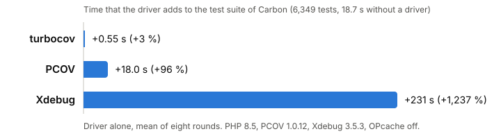

# turbocov

**Code coverage for PHP at near-native speed.**

- ⚡ **Fast:** 30× less overhead than PCOV, 400× less than Xdebug
- 🎯 **Precise:** Reports the same lines as PCOV
- 🪶 **Pay for what you measure:** Collect only the files you changed, the rest runs untouched
- 🍰 **Easy-to-use:** One extension, one line in `phpunit.xml`
- 🛡️ **Never silently wrong:** A broken setup stops the run with a clear message
- ✨ **Modern:** PHP 8.4 – 8.5, PHPUnit 13.3+

## Comparison



|                             | turbocov | PCOV                 | Xdebug               |
|-----------------------------|----------|----------------------|----------------------|
| Time added to a test run*   | **+3 %** | +96 %                | +1,237 %             |
| Line coverage               | ✅       | ✅                   | ✅                   |
| Collect only selected files | ✅       | ⚠️ slow for the rest | ⚠️ slow for the rest |
| Branch & path coverage      | ❌       | ❌                   | ✅                   |

<sup><sub>\*Driver alone on the test suite of Carbon (6,349 tests). Run it yourself: [benchmark/](benchmark/README.md)</sub></sup>

## Installation

```sh
pie install shipmonk/turbocov
composer require --dev shipmonk/turbocov-phpunit
```

## Usage

Tell PHPUnit to use it:

```xml
<coverage driver="ShipMonk\Turbocov\TurbocovDriver"/>
```

Run your tests:

```sh
php -d turbocov.collect_paths=src vendor/bin/phpunit --coverage-html coverage
```

Only want coverage for what your branch changed? Pay for nothing else:

```sh
git diff --name-only --diff-filter=AMR origin/master...HEAD -- '*.php' > changed.txt
php -d turbocov.collect_paths=@changed.txt vendor/bin/phpunit --coverage-clover clover.xml
```

turbocov is new. Read the [limits](#limits) before you rely on it. The package [shipmonk/turbocov-phpunit](https://github.com/shipmonk-rnd/turbocov-phpunit) has the PHPUnit driver and its details.

## How it works

PCOV and Xdebug do work for each instruction that PHP executes. turbocov does work only when a line runs for the first time.

1. PHP compiles a file into opcodes. Each opcode has a pointer to its handler.
2. For a whitelisted file, turbocov replaces the handler of the first opcode of each line with a probe.
3. When a probe fires, it records the line and puts the original handler back. PHP then executes the same opcode again.
4. From that moment the line runs without a probe.
5. `stop()` arms the fired probes again. The cost of a test run is in proportion to the number of lines that the test touched.

turbocov does not replace the instruction loop of PHP. Code without probes runs as if the extension is not loaded.

## Requirements

- PHP 8.4 or 8.5, non-thread-safe build.
- Linux or macOS.
- The CLI SAPI.
- OPcache off, or OPcache on with `opcache.optimization_level=0`.

## Build from source

```sh
phpize
./configure --enable-turbocov
make
make test
```

Load the result with `extension=/path/to/modules/turbocov.so`.

## Settings

| Setting | Default | Description |
|---|---|---|
| `turbocov.enabled` | `1` | Set `0` to turn the extension off. It then has no effect at all. |
| `turbocov.collect_paths` | none | The files and directories that get probes. A directory includes all files below it. |
| `turbocov.exclude_paths` | none | The files and directories that get no probes. |
| `turbocov.exclude_pattern` | none | A PCRE pattern. Files with a matching path get no probes. |

The two path settings take one of these values:

- A list of paths with `:` between them: `src:config/services.php`.
- `@` and the name of a list file: `@changed.txt`. The list file has one path on each line.

Rules:

- A relative path starts at the working directory.
- A path that does not exist is an error: `start()` throws an exception. A list file with no paths is not an error, and turbocov then collects nothing.
- A pattern that is not valid is an error too.
- Without `turbocov.collect_paths` turbocov collects nothing, and `start()` throws an exception.
- The settings apply when PHP compiles a file. Set them in `php.ini` or with `-d`, not with `ini_set()`.

## Functions

```php
\turbocov\ensure_can_collect();      // throw \turbocov\CannotCollectException when the collection cannot work
\turbocov\start();                   // start the collection; throws the same exception
\turbocov\stop();                    // stop the collection; file => line => 1 for the lines that ran since start()
\turbocov\get_executable_lines(      // file => line => -1 for each executable line of the given files
    ['/absolute/path/File.php'],
);
\turbocov\get_debug_info(            // the state of one file, for a person
    '/absolute/path/File.php',
);
```

- `ensure_can_collect()` and `start()` throw `\turbocov\CannotCollectException` when turbocov cannot collect coverage. The message has the reason, for example `turbocov.collect_paths is not set`. The class extends `RuntimeException`.
- `ensure_can_collect()` does not start the collection. A coverage tool calls it one time before the first test.
- `stop()` returns only the lines that ran. It also arms the probes again, so the next `start()` begins with no data.
- A file that PHP loaded during the collection is in the result of `stop()`, also when none of its lines ran.
- `get_executable_lines()` knows only the files that PHP compiled and that are in `turbocov.collect_paths`. Other files are not in the result.

A coverage tool needs the lines that did not run only once for each file:

```php
$executed = \turbocov\stop();
$newFiles = array_diff_key($executed, $seenFiles);

foreach (\turbocov\get_executable_lines(array_keys($newFiles)) as $file => $lines) {
    $executed[$file] = array_replace($lines, $executed[$file]);
    $seenFiles[$file] = true;
}
```

### Debug data

`get_debug_info()` is for a person who looks for the cause of a result. Its format can change in each version. Do not use it in a tool.

It returns the probes of one file:

```php
[
    'skip_reason'      => null,   // or the reason why the file has no data
    'executable_lines' => [5, 6, 9],
    'units'            => [       // one for each function, method and closure
        [
            'name'   => 'Foo::bar',
            'probes' => [
                ['line' => 5, 'opnum' => 1, 'opcode' => 'ZEND_IS_SMALLER', 'state' => 'fired'],
                ['line' => 6, 'opnum' => 3, 'opcode' => 'ZEND_RETURN', 'state' => 'armed'],
            ],
        ],
    ],
]
```

- `skip_reason` tells if the file is not in `turbocov.collect_paths`, if an exclude setting has it, or if PHP did not compile it.
- `state` is `armed`, `fired` or `fired while the collection was off`.
- The code of a file outside of all functions has the name `{main}`. PHP destroys that code after it ran, so it is usually not in the list.

## PHPUnit before 13.3 and other tools that only know PCOV

These tools select their PCOV driver when an extension with the name `pcov` is loaded. A build option makes turbocov register with that name:

```sh
./configure --enable-turbocov --enable-turbocov-impersonate-pcov
```

PHPUnit and other tools that support PCOV then work without a change. This build is a temporary aid, and a later version can remove it.

- The functions are the functions of PCOV: `\pcov\start()`, `stop()`, `waiting()`, `collect()`, `clear()` and `memory()`. The functions of the section above do not exist in this build.
- The settings are `pcov.enabled`, `pcov.directory` (as `turbocov.collect_paths`) and `pcov.exclude` (as `turbocov.exclude_pattern`).
- `pcov.directory` has no default. PCOV uses `src`, `lib` or `app` when the setting is empty; turbocov collects nothing.
- `\pcov\start()` does not throw an exception. It gives a warning when turbocov cannot collect coverage.
- Do not load the real PCOV at the same time.

## Limits

- OPcache: turbocov puts its probes into the code that OPcache caches. This is not possible with `opcache.protect_memory=1`, with `opcache.file_cache`, with `opcache.preload`, with the JIT, and in a SAPI other than the CLI. In these cases `start()` throws an exception.
- OPcache optimizer: `start()` throws an exception when OPcache is on and `opcache.optimization_level` is not `0`. The optimizer removes code. A line without code has no probe, and the report then shows a line as not covered although the test ran it.
- Xdebug and PCOV: `start()` throws an exception when one of them is loaded, also when it is not active. Xdebug is not tested together with turbocov. PCOV replaces the instruction loop of PHP, and turbocov is then slow.
- phpdbg replaces the instruction loop too. turbocov is then slow. The results stay correct.
- `pcntl_fork()` with OPcache on: the parent process and the child process share the cached code. A probe that fires in one process is gone for the other, and lines can be missing.
- An extension that registers opcode handlers after turbocov replaces the handler of turbocov. Probes on those opcodes then record nothing.
- No branch coverage, no path coverage, no detection of dead code.
- Property hooks: turbocov reports their lines. PCOV 1.0.12 does not report them; the `develop` branch of PCOV does, and it gives the same line data as turbocov. With PHPUnit 13, a report of turbocov thus has lines that a report of PCOV 1.0.12 does not have.
- In the build with the name `pcov`, `clear(true)` does not drop the file list. The argument has no effect.

## Development

The scripts in `dev/` need Docker. They limit each container to 2 GB of memory.

```sh
RUN_TESTS=1 dev/build.sh 8.5                 # build and run the tests
dev/build.sh 8.5 pcov                        # build with the name pcov
dev/compare-with-pcov.sh 8.5 path/File.php   # compare the line data with PCOV
dev/bench.sh 8.5                             # compare the speed with plain PHP and PCOV
```

The source is in `src/`:

| File | Content |
|---|---|
| `turbocov.c` | The module: settings, startup and shutdown |
| `compiler.c` | The compile hooks and the installation of probes |
| `probes.c` | The probe handler and the lists of fired probes |
| `paths.c` | The settings that select the files |
| `conflicts.c` | The setups in which probes cannot work |
| `api_native.c` | The functions for PHP code |
| `api_pcov.c` | The functions of PCOV, for the build with the name `pcov` |
| `debug.c` | `get_debug_info()` and `get_status()` |

## License

MIT. See [LICENSE](LICENSE).
